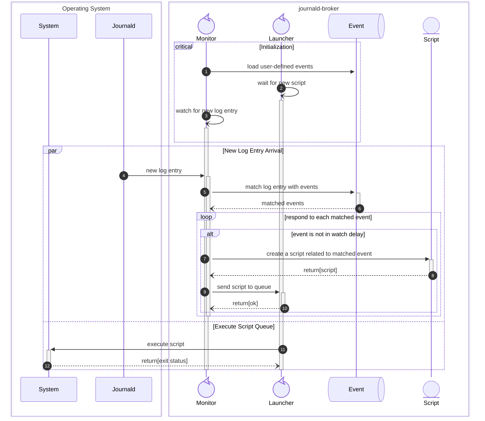

# journald-broker

[](https://github.com/bpetlert/journald-broker/releases/latest)
[](https://aur.archlinux.org/packages/journald-broker)
[](./COPYING)

**journald-broker** is a log-based event dispatcher daemon for systemd's journal.
The events are defined by user.
An event is generated by parsing log entries using a given regular expression.
Each event has a script attached to it, which is executed when the event is fired.

## Installation

### Arch Linux

**journald-broker** can be installed from [AUR](https://aur.archlinux.org/packages/journald-broker).
To build and install arch package from GIT source, try:

```bash
git clone https://github.com/bpetlert/journald-broker.git
cd journald-broker
makepkg -p PKGBUILD.local
pacman -U journald-broker-x.x.x.rx.gxxxxxxx-1-x86_64.pkg.tar.zst
```

Then enable/start `journald-broker.service`

```bash
systemctl enable --now journald-broker.service
```

## Usage

The configuration files, `*.conf` are stored in `/etc/journald-broker.d/`.
The configuration files are loaded in alphabetical order.
The later occurrences of config will override previous ones.
User is allowed to define event as many times as needed.
Each event must has a unique name.
A script for each event must be a regular executable file owned by root.

When an event is dispatched, the related information is passed to its script using environment variables below:

| Environment Variable | Description |
| --- | --- |
| `JNB_MESSAGE` | Error log message |
| `JNB_JSON` | Full journal log entry, encoded in JSON format. |

### Example 1: Extract a specific log to file

This example shows how to extract log message that start start with `xhci_hcd 0000:04:00.0: WARN`.
Then write log entry to external file.

```toml
# /etc/journald-broker.d/01-extract-xhci_hcd-error.conf

[events.extract-xhci_hcd-error]
message = 'xhci_hcd 0000:04:00\.0: WARN.*'
script = "/usr/local/bin/extract-xhci_hcd-error.sh"
```

```bash
#!/usr/bin/env bash

# /usr/local/bin/extract-xhci_hcd-error.sh

echo ${JNB_JSON} >> /path/to/log/file

exit 0
```

### Example 2: Workaround error of xhci_hcd when connect to USB-3.0-to-Ethernet

The _USB 3.0 to ethernet adapter_ device on xhci_hcd bus will sometime stop functioning until reconnect or rebind.
The error will show in journal log as show below:

```bash
[ 1179.475926] kernel: xhci_hcd 0000:04:00.0: WARN: TRB error for slot 1 ep 5 on endpoint
[ 1179.607026] kernel: xhci_hcd 0000:04:00.0: WARN waiting for error on ep to be cleared
[ 1179.607049] kernel: xhci_hcd 0000:04:00.0: WARN waiting for error on ep to be cleared
[ 1179.607054] kernel: xhci_hcd 0000:04:00.0: WARN waiting for error on ep to be cleared
[ 1179.607058] kernel: xhci_hcd 0000:04:00.0: WARN waiting for error on ep to be cleared
```

In this example, `journald-broker` will monitor only the warning message (`PRIORITY=4`) of kernel log (`_TRANSPORT=kernel`).
After the these error messages are found, it will automatically rebind the device.
Since the log message will repeat really fast, the event will be fired repeatedly and attempt to rebind the device again.
It would be undesirable result.
To prevent this, it is necessary to slow down for firing the same event by using `next-watch-delay` setting.

```toml
# /etc/journald-broker.d/02-xhci_hcd-error.conf

[global]
filters = ["_TRANSPORT=kernel", "PRIORITY=4"]

[events.xhci_hcd-error]
message = 'xhci_hcd 0000:04:00\.0: WARN waiting for error on ep to be cleared'
next-watch-delay = "1 minute"
script = "/usr/local/bin/xhci_hcd-rebind.sh"
```

```bash
#!/usr/bin/env bash

# /usr/local/bin/xhci_hcd-rebind.sh

# Record system info (in JSON format) to journal
sys_info="
{
  \"ErrorLog\": \"${JNB_MESSAGE}\",
  \"SysInfo\": [
    \"$(uname --kernel-name)-$(uname --kernel-release)-$(uname --machine) $(uname --kernel-version)\",
    \"$(pacman -Qi asix-ax88179-dkms | grep Version | awk '{ print "asix-ax88179-dkms-"$3 }')\" ]
}"
echo $sys_info | /usr/bin/jq --compact-output --monochrome-output

# Disconnect device
echo "Unbind => ASIX Electronics Corp. AX88179 Gigabit Ethernet"
echo -n "0000:04:00.0" > /sys/bus/pci/drivers/xhci_hcd/unbind
sleep 3s

# Reconnect device
echo "Bind => ASIX Electronics Corp. AX88179 Gigabit Ethernet"
echo -n "0000:04:00.0" > /sys/bus/pci/drivers/xhci_hcd/bind

exit 0
```

## Design



## License

[GNU General Public License v3.0 or later](./COPYING)
